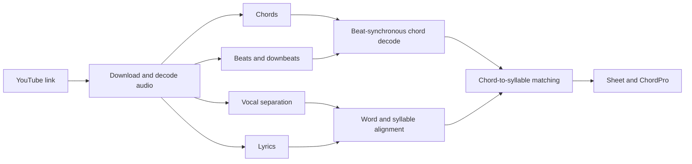

# Anvil

Anvil is a proof of concept that turns a YouTube link into a chord-over-lyrics sheet, for guitarists who want a song's chords placed above the words.

## What it does

- Takes a YouTube link, downloads the audio and works out the chords, the beat grid and the key.
- Finds the lyrics: synced lyrics from LRCLIB when the song is known, otherwise speech recognition on the separated vocal track.
- Places each chord change above the syllable where it lands, writes instrumental passages one chord per bar, and labels sections such as verse and chorus.
- Shows the result as a plain-text two-line sheet or as ChordPro, with transpose and copy.
- Accepts work through a job queue, so another app (Klank) can submit a link, or a whole playlist, and collect the sheet later.

## How it is built

- A TypeScript monorepo (pnpm workspaces): a platform-agnostic pipeline core, a Node.js server with an Express job API, a React and Vite viewer, and a job queue built on Node's own HTTP and SQLite modules.
- The audio models run as side-car processes that the server launches: SheetSage2 or BTC for chords, Beat This! for beats, Demucs or Mel-Band RoFormer for vocal separation, Qwen3-ASR and Qwen3-ForcedAligner for lyrics, SongFormer for song structure.
- The heavy model stages share one GPU through a first-in, first-out lock. Every stage degrades instead of failing, so a machine without the models still produces a sheet.
- A benchmark harness scores chords, word timing and lyrics against reference data before a model or tuning change.
- The queue ships as a container with a Helm chart; the GPU worker runs as a systemd user service.

## Status

A proof of concept for personal, experimental use. Chord placement and syllable splitting are approximate, and the repository documents its known limitations.
